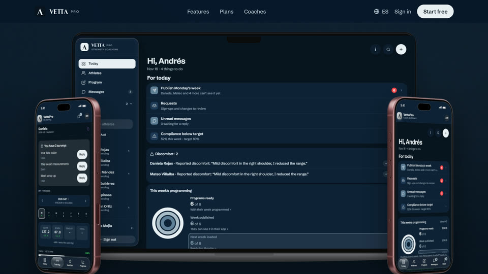

<h1>EYVER GÓMEZ</h1>

<samp>INGENIERO FRONTEND&nbsp;&nbsp;&nbsp;&nbsp;&nbsp;&nbsp;<b>CÓDIGO ABIERTO</b>&nbsp;&nbsp;&nbsp;&nbsp;&nbsp;&nbsp;<b>● DISPONIBLE PARA TRABAJAR</b></samp>

 

<samp>
<b><a href="https://eyversgo.github.io/">EYVERSGO:</a>&nbsp;&nbsp;&nbsp;&nbsp;&nbsp;&nbsp;&nbsp;&nbsp;&nbsp;&nbsp;&nbsp;&nbsp;&nbsp;&nbsp;&nbsp;&nbsp;&nbsp;&nbsp;&nbsp;&nbsp;&nbsp;&nbsp;&nbsp;(PERFIL&nbsp;PERSONAL&nbsp;DE&nbsp;GITHUB&nbsp;Y&nbsp;PORTAFOLIO)</b>  
<b>ÍNDICE&nbsp;01:&nbsp;STACK&nbsp;&nbsp;&nbsp;&nbsp;&nbsp;&nbsp;&nbsp;&nbsp;&nbsp;(REACT,&nbsp;VUE,&nbsp;TYPESCRIPT,&nbsp;NEXT.JS,&nbsp;TAILWIND&nbsp;CSS)</b>  
<b>ÍNDICE&nbsp;02:&nbsp;ENFOQUE&nbsp;&nbsp;&nbsp;&nbsp;&nbsp;&nbsp;(RENDIMIENTO,&nbsp;ACCESIBILIDAD,&nbsp;SISTEMAS&nbsp;DE&nbsp;DISEÑO)</b>  
<b>ÍNDICE&nbsp;03:&nbsp;CÓDIGO&nbsp;ABIERTO&nbsp;&nbsp;&nbsp;&nbsp;&nbsp;&nbsp;&nbsp;&nbsp;&nbsp;&nbsp;&nbsp;&nbsp;&nbsp;&nbsp;&nbsp;&nbsp;(LIBRERÍAS,&nbsp;HERRAMIENTAS,&nbsp;DOCS)</b>
   
Creo&nbsp;interfaces&nbsp;web&nbsp;limpias,&nbsp;rápidas&nbsp;y&nbsp;accesibles,&nbsp;y&nbsp;contribuyo&nbsp;al&nbsp;&nbsp;&nbsp;&nbsp;&nbsp;&nbsp; 
ecosistema&nbsp;de&nbsp;código&nbsp;abierto.&nbsp;&nbsp;&nbsp;&nbsp;&nbsp;&nbsp;&nbsp;&nbsp;&nbsp;&nbsp;&nbsp;&nbsp;&nbsp;&nbsp;&nbsp;&nbsp;&nbsp;&nbsp;&nbsp;&nbsp;&nbsp;&nbsp;&nbsp;&nbsp;&nbsp;&nbsp;&nbsp;&nbsp;&nbsp;&nbsp;&nbsp;&nbsp;&nbsp;&nbsp;&nbsp;&nbsp;&nbsp;&nbsp;&nbsp;&nbsp;&nbsp;&nbsp;&nbsp;
</samp>

 

<samp>
<b>PROYECTOS:&nbsp;&nbsp;&nbsp;&nbsp;&nbsp;&nbsp;&nbsp;&nbsp;&nbsp;&nbsp;&nbsp;&nbsp;&nbsp;&nbsp;&nbsp;&nbsp;&nbsp;&nbsp;&nbsp;&nbsp;&nbsp;&nbsp;&nbsp;(TRABAJO&nbsp;SELECCIONADO,&nbsp;EN&nbsp;GITHUB&nbsp;PAGES)</b>  
<b><a href="https://eyversgo.github.io/">WEB&nbsp;00:&nbsp;PORTAFOLIO</a>&nbsp;&nbsp;&nbsp;&nbsp;&nbsp;&nbsp;&nbsp;&nbsp;&nbsp;&nbsp;&nbsp;&nbsp;&nbsp;&nbsp;&nbsp;&nbsp;&nbsp;&nbsp;&nbsp;(EYVERSGO.GITHUB.IO,&nbsp;HTML,&nbsp;CSS,&nbsp;JS)</b>  
<b><a href="https://eyversgo.github.io/apple-rebuilt">TRABAJO&nbsp;01:&nbsp;APPLE&nbsp;REBUILT</a>&nbsp;&nbsp;&nbsp;&nbsp;&nbsp;&nbsp;&nbsp;&nbsp;&nbsp;&nbsp;&nbsp;&nbsp;&nbsp;&nbsp;&nbsp;&nbsp;&nbsp;&nbsp;&nbsp;(CLON&nbsp;DE&nbsp;APPLE.COM,&nbsp;PRIVADO)</b>  
<b><a href="https://eyversgo.github.io/vetta">TRABAJO&nbsp;02:&nbsp;VETTAPRO</a>&nbsp;&nbsp;&nbsp;&nbsp;&nbsp;&nbsp;&nbsp;&nbsp;&nbsp;&nbsp;&nbsp;&nbsp;&nbsp;&nbsp;&nbsp;&nbsp;(APP&nbsp;DE&nbsp;COACHING&nbsp;DE&nbsp;FUERZA,&nbsp;PRIVADO)</b>
</samp>

<samp><a href="https://eyversgo.github.io/vetta"><b>VER LA DEMO</b></a>&nbsp;&nbsp;&nbsp;&nbsp;&nbsp;&nbsp;<a href="https://vettapro.web.app"><b>ABRIR LA APP</b></a>&nbsp;&nbsp;&nbsp;&nbsp;&nbsp;&nbsp;<a href="https://eyversgo.github.io/contact"><b>PEDIR ACCESO</b></a></samp>

 

<samp><a href="https://www.instagram.com/eyversgo/"><b>INSTAGRAM @EYVERSGO</b></a>&nbsp;&nbsp;&nbsp;&nbsp;&nbsp;&nbsp;<a href="https://eyversgo.github.io/assets/cv/Eyver-Gomez-CV-ES.pdf"><b>CV</b></a>&nbsp;&nbsp;&nbsp;&nbsp;&nbsp;&nbsp;<a href="https://cal.com/eyversgo/15min"><b>AGENDAR LLAMADA</b></a>&nbsp;&nbsp;&nbsp;&nbsp;&nbsp;&nbsp;<a href="mailto:eyversgo@gmail.com"><b>EMAIL</b></a>&nbsp;&nbsp;&nbsp;&nbsp;&nbsp;&nbsp;<a href="https://github.com/eyversgo"><b>GITHUB</b></a>&nbsp;&nbsp;&nbsp;&nbsp;&nbsp;&nbsp;<b><a href="README.md">ENGLISH</a></b></samp>

