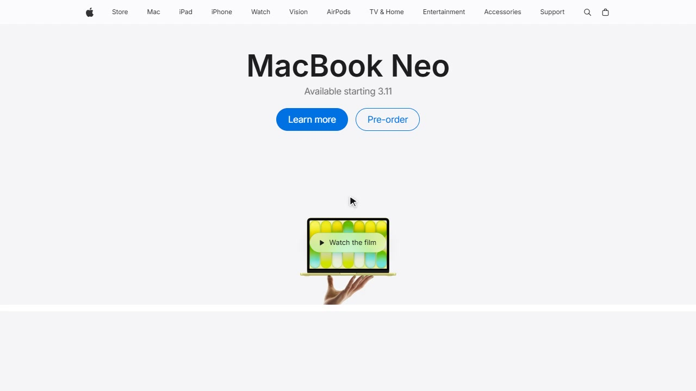

<h1>EYVER GÓMEZ</h1>

<samp>FRONTEND ENGINEER&nbsp;&nbsp;&nbsp;&nbsp;&nbsp;&nbsp;<b>OPEN SOURCE CONTRIBUTOR</b>&nbsp;&nbsp;&nbsp;&nbsp;&nbsp;&nbsp;<b>● AVAILABLE FOR WORK</b></samp>

 

<samp>
<b><a href="https://eyversgo.github.io/">EYVERSGO:</a>&nbsp;&nbsp;&nbsp;&nbsp;&nbsp;&nbsp;&nbsp;&nbsp;&nbsp;&nbsp;&nbsp;&nbsp;&nbsp;&nbsp;&nbsp;&nbsp;&nbsp;&nbsp;&nbsp;&nbsp;&nbsp;&nbsp;&nbsp;&nbsp;(PERSONAL&nbsp;GITHUB&nbsp;PROFILE&nbsp;AND&nbsp;PORTFOLIO)</b>  
<b>INDEX&nbsp;01:&nbsp;CORE&nbsp;STACK&nbsp;&nbsp;&nbsp;&nbsp;&nbsp;(REACT,&nbsp;VUE,&nbsp;TYPESCRIPT,&nbsp;NEXT.JS,&nbsp;TAILWIND&nbsp;CSS)</b>  
<b>INDEX&nbsp;02:&nbsp;FOCUS&nbsp;AREAS&nbsp;&nbsp;&nbsp;&nbsp;&nbsp;&nbsp;&nbsp;(PERFORMANCE,&nbsp;ACCESSIBILITY,&nbsp;DESIGN&nbsp;SYSTEMS)</b>  
<b>INDEX&nbsp;03:&nbsp;OPEN&nbsp;SOURCE&nbsp;&nbsp;&nbsp;&nbsp;&nbsp;&nbsp;&nbsp;&nbsp;&nbsp;&nbsp;&nbsp;(LIBRARIES,&nbsp;TOOLS&nbsp;&amp;&nbsp;UI,&nbsp;DOCS&nbsp;&amp;&nbsp;EXAMPLES)</b>
   
Crafting&nbsp;clean,&nbsp;performant&nbsp;and&nbsp;accessible&nbsp;web&nbsp;interfaces.&nbsp;Building&nbsp;&nbsp;&nbsp;&nbsp;&nbsp;&nbsp; 
better&nbsp;web&nbsp;experiences&nbsp;and&nbsp;actively&nbsp;contributing&nbsp;to&nbsp;the&nbsp;open-source&nbsp;&nbsp;&nbsp;&nbsp;&nbsp; 
ecosystem.&nbsp;&nbsp;&nbsp;&nbsp;&nbsp;&nbsp;&nbsp;&nbsp;&nbsp;&nbsp;&nbsp;&nbsp;&nbsp;&nbsp;&nbsp;&nbsp;&nbsp;&nbsp;&nbsp;&nbsp;&nbsp;&nbsp;&nbsp;&nbsp;&nbsp;&nbsp;&nbsp;&nbsp;&nbsp;&nbsp;&nbsp;&nbsp;&nbsp;&nbsp;&nbsp;&nbsp;&nbsp;&nbsp;&nbsp;&nbsp;&nbsp;&nbsp;&nbsp;&nbsp;&nbsp;&nbsp;&nbsp;&nbsp;&nbsp;&nbsp;&nbsp;&nbsp;&nbsp;&nbsp;&nbsp;&nbsp;&nbsp;&nbsp;&nbsp;&nbsp;&nbsp;&nbsp;
</samp>

 

<samp>
<b>PROJECTS:&nbsp;&nbsp;&nbsp;&nbsp;&nbsp;&nbsp;&nbsp;&nbsp;&nbsp;&nbsp;&nbsp;&nbsp;&nbsp;&nbsp;&nbsp;&nbsp;&nbsp;&nbsp;&nbsp;&nbsp;&nbsp;&nbsp;&nbsp;&nbsp;&nbsp;&nbsp;(SELECTED&nbsp;WORK,&nbsp;LIVE&nbsp;ON&nbsp;GITHUB&nbsp;PAGES)</b>  
<b><a href="https://eyversgo.github.io/">WEB&nbsp;00:&nbsp;PORTFOLIO</a>&nbsp;&nbsp;&nbsp;&nbsp;&nbsp;&nbsp;&nbsp;&nbsp;&nbsp;&nbsp;&nbsp;&nbsp;&nbsp;&nbsp;&nbsp;&nbsp;&nbsp;&nbsp;&nbsp;&nbsp;(EYVERSGO.GITHUB.IO,&nbsp;HTML,&nbsp;CSS,&nbsp;JS)</b>  
<b><a href="https://eyversgo.github.io/apple-rebuilt">WORK&nbsp;01:&nbsp;APPLE&nbsp;REBUILT</a>&nbsp;&nbsp;&nbsp;&nbsp;&nbsp;&nbsp;&nbsp;&nbsp;&nbsp;&nbsp;&nbsp;&nbsp;&nbsp;(APPLE.COM&nbsp;CLONE,&nbsp;PRIVATE&nbsp;REPOSITORY)</b>
</samp>

<samp><a href="https://eyversgo.github.io/apple-rebuilt"><b>WATCH THE DEMO</b></a>&nbsp;&nbsp;&nbsp;&nbsp;&nbsp;&nbsp;<a href="https://eyversgo.github.io/contact"><b>REQUEST ACCESS</b></a>&nbsp;&nbsp;&nbsp;&nbsp;&nbsp;&nbsp;<a href="https://eyversgo.github.io/"><b>PORTFOLIO</b></a></samp>

 

<samp><a href="https://www.instagram.com/eyversgo/"><b>INSTAGRAM @EYVERSGO</b></a>&nbsp;&nbsp;&nbsp;&nbsp;&nbsp;&nbsp;<a href="https://eyversgo.github.io/assets/cv/Eyver-Gomez-CV-EN.pdf"><b>CV</b></a>&nbsp;&nbsp;&nbsp;&nbsp;&nbsp;&nbsp;<a href="https://cal.com/eyversgo/15min"><b>BOOK A CALL</b></a>&nbsp;&nbsp;&nbsp;&nbsp;&nbsp;&nbsp;<a href="mailto:eyversgo@gmail.com"><b>EMAIL</b></a>&nbsp;&nbsp;&nbsp;&nbsp;&nbsp;&nbsp;<a href="https://github.com/eyversgo"><b>GITHUB</b></a>&nbsp;&nbsp;&nbsp;&nbsp;&nbsp;&nbsp;<b><a href="README-ES.md">ESPAÑOL</a></b></samp>

